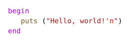
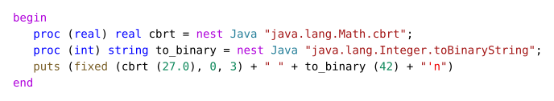
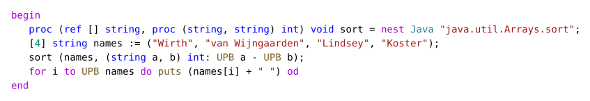
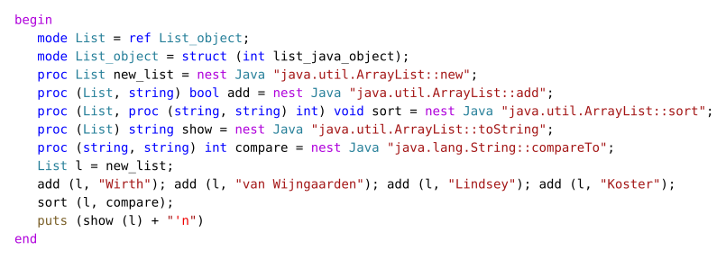
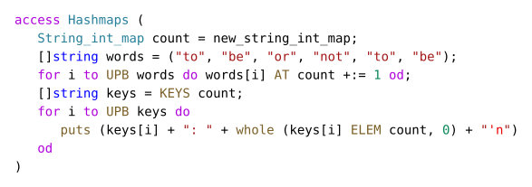
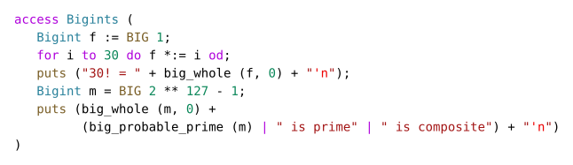

[](https://central.sonatype.com/artifact/io.github.stefan-zobel/a68j)
[](https://javadoc.io/doc/io.github.stefan-zobel/a68j)
[](COPYING)

# a68j - Algol 68 on the JVM

Algol 68 anticipated by decades much of what modern languages take for
granted - orthogonal design, expression orientation, type-safe unions,
user-defined operators and built-in concurrency - and its ideas live on
in languages such as C++ and Python.

**a68j** compiles [Algol 68](https://en.wikipedia.org/wiki/ALGOL_68) to Java
bytecode. Its front end is a faithful, file-by-file Java port of [ga68](https://gcc.gnu.org/wiki/Algol68FrontEnd),
the Algol 68 front end of GCC. The back end generates JVM class files with
the JDK's ClassFile API.

It is verified by differential testing against ga68. Every program in the
test corpora must produce the same output and exit status on the JVM as
with **ga68**:
- the ga68 test suite,
- almost 650 Rosetta Code programs,
- the project's own tests.

[](examples/hello.a68)

```
$ java -jar a68j-backend.jar -run hello.a68
Hello, world!
```

## Why

- **Same language as ga68.** a68j reads the dialect that GCC's Algol 68
  front end reads: GNU Algol 68 with [SUPPER stropping](https://algol68-lang.org/docs/GNU68-2025-004-supper.html/index.html)
  (the default) or UPPER stropping, modules (`module … def … fed`, `access`)
  and formal holes. It reports the same diagnostics at the same positions,
  because scanner, parser, mode checker and the other passes are the ported
  ga68 code.
- **Runs wherever Java runs.** One jar, no native toolchain.
- **Reasonably fast.** Faster than ga68 without optimization on
  longer-running programs, about 1.6 times the time of ga68 `-O2` in the
  median, and as fast as `-O2` on a long numeric program (plus the JVM's
  start-up). Values of the
  primitive modes are kept unboxed, calls are direct, and the generated
  code is shaped for the JIT. See [Performance](#performance).
- **Java interoperability** (an a68j extension, off by default):
  `nest Java "java.lang.Math.cbrt"` binds a Java method like ga68's
  `nest C` binds a C function. Algol 68 procedures can be passed as Java
  functional interfaces (a comparator for `Arrays.sort`, say) and come
  back as procedures. Constructors, instance methods and fields are bound as
  method references (`nest Java "java.util.ArrayList::new"`), so objects of
  the JDK can be used directly. Where several overloads fit, the types of
  the parameters name one (`"org.xml.sax.InputSource::new(Reader)"`). The bundled modules `Lists` and
  `Hashmaps` provide growable lists and hash maps built on it, and
  `Bigints` integers of any size with the operators of an `int`
  ([docs/bigints.md](docs/bigints.md)), and `Bigdecimals` decimals of any
  precision with the operators of a `real`
  ([docs/bigdecimals.md](docs/bigdecimals.md)).
- **Partial parametrization** (an extension of Algol 68 Genie, after
  Lindsey's proposal of 1976): a call that leaves arguments out,
  `add (3, )`, yields a procedure of the missing parameters. ga68 accepts
  such a call but cannot compile it yet whereas a68j can.

## Status

| Check | Result |
|---|---|
| Front end vs. ga68 | trees after semantic analysis identical node by node; same diagnostics (up to the ga68 commits listed in `docs/PORTING.md`) |
| ga68 test suite (execution tests) | 524 of 525 (the other one prints `argv (1)`, the path of the executable, which necessarily differs) |
| a68j's own differential tests (`tests/extra`) | 56 of 56 |
| Rosetta Code programs that ga68 runs | 699 identical (642 of them end normally), 6 equal up to floating-point rounding, 11 open, of 716 |
| Module tests built as library jars | 25 of 25 |
| Java interop and bundled modules (`tests/java`) | 94 of 94, JDK 25 and JDK 28 |
| Parallel clauses with real threads (`tests/par`) | 14 of 14, JDK 25 and JDK 28 |
| Partial parametrization, compared with Algol 68 Genie (`tests/partial`) | 16 of 16 (7 of them up to the widths and the rounding of numbers), JDK 25 and JDK 28 |
| Command-line options and compiler messages (`tests/options`, `tests/scope`) | 40 of 40, JDK 25 and JDK 28 |
| Formats: rewrite tool, `Genie_Formats`, `-fgenie`, `-fformats` (`tests/formats`) | 87 of 87 on a68j, with `-fgenie`, and with `-fgenie` and the rewrite of format texts; also on ga68 and Algol 68 Genie where they apply (7 deliberate differences from Algol 68 Genie excepted) |

Not supported, as in ga68: the transput of the Revised Report (`print`,
`newline`, `put`, `$…$` formats); output goes through the POSIX
prelude (`puts`, `putchar`, `fputs` ...). The bundled Algol 68 module
`Genie_Transput` provides `print`, `newline`, `put`, `read`, `get`, `open`,
`associate` and `stand_out` in the style of Algol 68 Genie on top of it, for a68j and
ga68 alike
([docs/genie-transput.md](docs/genie-transput.md)). Format texts
(`$...$`, `printf`, `readf`) become calls of the bundled module
`Genie_Formats`, with insertions, replicators, `g`, `f`, pictures,
choices, radix, `k` and the complex pattern `i`, for output and input
([docs/genie-formats.md](docs/genie-formats.md)): a68j compiles them with
the option `-fformats`, and for ga68 a rewrite tool, written in Algol 68,
turns them into such calls first. `-fgenie` does all this, so that a
program written for Algol 68 Genie runs as it is; with these options,
records and rows of rows are items of `print`, `printf`, `read` and
`readf` too.
 
The bundled module
`Texts`, also in plain Algol 68, adds string functions: case, trimming,
splitting, joining, replacing, padding, and strings to numbers
([docs/texts.md](docs/texts.md)); `Regex` offers the regular expressions
of Algol 68 Genie (`grep in string`, `sub in string`) on top of
`java.util.regex`, for a68j only ([docs/regex.md](docs/regex.md)), and
`Files` the file procedures of Algol 68 Genie (`get directory`,
`file is directory`) and more: whole files read and written as strings,
directories listed and walked, files moved, copied and deleted, also for
a68j only ([docs/files.md](docs/files.md)). `Times` has the time
procedures of Algol 68 Genie (`local time`, `utc time`, `cpu time`,
`sleep`) and
dates, date-times and durations on top of `java.time`, with operators for
their arithmetic, patterns for text, and time zones, for a68j only
([docs/times.md](docs/times.md)).

`long long int` has 64 bits, as in ga68, where Algol 68 Genie has 72
digits; for larger integers the `Bigints` module offers the mode `Bigint`, with the
operators of an `int`, on top of `java.math.BigInteger`, for a68j only
([docs/bigints.md](docs/bigints.md)). 80-bit `long long real` is out of
scope; for more digits the `Bigdecimals` module offers the mode
`Bigdecimal`, decimals with a precision of 70 digits or any other, on top
of `java.math.BigDecimal`, for a68j only
([docs/bigdecimals.md](docs/bigdecimals.md)).

## Requirements

- **JDK 25** or later to build and run. JDK 28 is optional: with it the jar
  also contains a version of the PAR runtime based on [structured concurrency](https://openjdk.org/jeps/543).
- A POSIX shell to build (Linux, macOS, WSL or Git Bash on Windows).
- For the differential tests only: a build of GCC with Algol 68 (`ga68`)
  and Python 3.

## Build

```sh
cd backend
JDK25=/path/to/jdk-25 JDK28=/path/to/jdk-28 sh build.sh
```

`JDK25` and `JDK28` name the JDK directories (not their `bin`
directories); `JDK28` is optional, and `JDK25` may also be a newer JDK.
This builds the front end (`a68j.jar`) and then `backend/a68j-backend.jar`,
which contains everything: front end, code generator, runtime, the
standard prelude and the bundled modules. Next to the jar it writes
`a68j-backend.aot`, an AOT cache that shortens the start of the compiler
(JEP 483). The cache is optional. It also writes `a68j-runtime.jar`,
which holds only the runtime, the standard prelude and the bundled
modules: what a compiled program needs to run, without the compiler.
The version of a68j is in the file `VERSION`; `sh build.sh release` also
writes copies of the two jars with the version in their names to
`backend/dist`.

## Usage

Compile and run in one step:

```sh
java -jar a68j-backend.jar -run program.a68 [arguments]
```

Compile to class files, then run them:

```sh
java -jar a68j-backend.jar program.a68 -d out
java -cp a68j-backend.jar:out Program     # class named after the file
```

To ship a compiled program, `a68j-runtime.jar` is enough in place of
`a68j-backend.jar`. Library jars of modules (`-d libX.jar`) and the Java
classes that `nest Java` code uses go on the class path as well, in the
same way:

```sh
java -cp a68j-runtime.jar:lib/libmymod.jar:out Program
```

The runtime jar must come from the same version of a68j as the compiler
that compiled the program; a program checks this when it starts.

A program compiled into a jar (`-d prog.jar`) becomes an executable jar.
Its manifest names `a68j-runtime.jar` (or its release copy) and the jars
of the modules and of `-fjava-classpath` it uses, to be found next to it:

```sh
java -jar a68j-backend.jar -I lib program.a68 -d dist/program.jar
java -jar dist/program.jar      # a68j-runtime.jar and libmymod.jar in dist
```

Common options (as in ga68 where ga68 has them):

| Option | Meaning |
|---|---|
| `-fstropping=supper` / `-fstropping=upper` | stropping regime (default: SUPPER) |
| `-std=algol68` / `-std=gnu68` | strict Algol 68 or the GNU dialect (default) |
| `-I dir`, `-L dir` | where to find module interfaces (`X.m68`, `libX.jar`) |
| `-fmodules-map=…`, `-fmodules-map-file=…` | map module names to files, as in ga68 |
| `-fno-assert` | do not elaborate the assertions (`assert`) of the program (default: `-fassert`) |
| `-Wscope`, `-Wvoiding`, `-Wextensions`, `-Wunused`, `-Wuninitialized`, `-Whidden-declarations[=none\|prelude\|all]` | optional warnings of ga68, all off by default; `-Wno-…` turns one off, `-Wall` and `-Wextra` turn on groups of them as in ga68 |
| `-Wframe-scope` | warn about a procedure that outlives the elaboration it belongs to where a68j gives wrong results: a routine text of a loop that captures a declaration of the loop, or a jump to a label whose serial clause has been left (a68j warning, on by default; `-Wno-frame-scope` turns it off) |
| `-d dir` | output directory; `-d libX.jar` adds a module to a library jar, `-d prog.jar` makes an executable jar of a program |
| `-run` | compile in memory and run |
| `--version` | the version of a68j |
| `-fnest-java`, `-fjava-classpath=…` | allow `nest Java "…"` [formal holes](https://gcc.gnu.org/onlinedocs/gcc-16.1.0/ga68/Foreign-Function-Interface.html) (a68j extension) |
| `-fpar-threads` | run the units of `par` clauses in parallel threads (a68j extension) |
| `-fgenie` | run a program written for Algol 68 Genie, such as a Rosetta Code solution, as it is: UPPER stropping, `PR read`, apostrophes in strings, `FILE`, format texts, widening between lengths (`LONG INT x := 1`, `x +:= 1`), `ANDF`, `ORF`, `DOWNTO`, and access to `Genie_Transput`, `Genie_Formats`, `Regex`, `Files` and `Times` ([docs/genie-formats.md](docs/genie-formats.md); a68j extension) |
| `-fformats` | compile the format texts (`$...$`, `printf`) of a program written for a68j, in either stropping: they become calls of the module `Genie_Formats`, which an access to `Genie_Transput` brings in; errors in them are errors of the compiler, and records and rows of rows are items of `print`, `printf`, `read` and `readf` ([docs/genie-formats.md](docs/genie-formats.md); a68j extension) |

### Modules

A [module](https://gcc.gnu.org/onlinedocs/gcc-16.1.0/ga68/Modules.html) packet compiles to a class and an interface file `x.m68`. The
interface file is byte-identical with the `.a68_exports` section that ga68
writes for the same module. Several modules can go into one library jar:

```sh
java -jar a68j-backend.jar mymod.a68 -d lib/libmymod.jar
java -jar a68j-backend.jar -I lib -run program.a68
```

### Java methods and the bundled modules

[](examples/java-methods.a68)

```sh
java -jar a68j-backend.jar -fnest-java -run java-methods.a68
3.000 101010
```

Calls of such procedures go straight to the Java method: no boxing, no
argument arrays.

Procedures go to Java as objects of functional interfaces, and names of
rows as arrays that are copied back after the call:

[](examples/java-sort.a68)

```sh
java -jar a68j-backend.jar -fnest-java -run java-sort.a68
Wirth Koster Lindsey van Wijngaarden
```

Objects of any Java class are used through method references:
`Class::new` is a constructor, `Class::name` an instance method called on
the first parameter, or a public field if no method fits. In Algol 68
such an object is a name, and Java's
`null` is `nil`:

[](examples/java-objects.a68)

```sh
java -jar a68j-backend.jar -fnest-java -run java-objects.a68
[Koster, Lindsey, Wirth, van Wijngaarden]
```

The bundled module `Lists` offers growable lists
(`Intlist`, `Reallist`, `Stringlist`, …). `Hashmaps` offers hash maps for
`int`, `long int` and `string` keys (`String_int_map`, …). They need no
option:

[](examples/hashmaps.a68)

```sh
java -jar a68j-backend.jar -run hashmaps.a68
to: 2
be: 2
or: 1
not: 1
```

`Bigints` offers integers of any size (`Bigint`, on top of
`java.math.BigInteger`) with the operators of an `int`; each operand may
also be an `int`, `long int` or `long long int`. It needs no option either
([docs/bigints.md](docs/bigints.md)):

[](examples/bigints.a68)

```sh
java -jar a68j-backend.jar -run bigints.a68
30! = 265252859812191058636308480000000
170141183460469231731687303715884105727 is prime
```

## Performance

Measured on the 648 Rosetta Code programs that run with both
(`tests/rosetta/passing.txt`), all compiled beforehand. Each program runs
on its own, and the three variants of a program run right after each
other in rotating order, so that a machine that warms up and slows down
does not favor one of them. Each time is the median of three runs and
includes process start:

| | Total |
|---|---|
| ga68 `-O0` | 164.5 s |
| ga68 `-O2` | 70.2 s |
| a68j (JDK 25) | 144.5 s, of which about 39 s is JVM start-up (~0.06 s per program) |

For the 35 programs that run at least 0.3 s with ga68 `-O0`:

| | Total | Median ratio |
|---|---|---|
| a68j | 78.1 s | |
| ga68 `-O0` | 157.6 s | a68j / ga68 `-O0` = 0.74 |
| ga68 `-O2` | 66.3 s | a68j / ga68 `-O2` = 1.62 |

So **a68j** is faster than unoptimized **ga68** on longer-running
programs, and takes about 1.6 times as long as ga68 `-O2` in the median.

On a long-running program a68j catches up with `-O2`:
`tests/perf/big-program-1-long.a68` (14 numeric kernels in one main
program, ten times the work of `big-program-1.a68`), median of three runs
in rotating order, with the same output for all three:

| | Time |
|---|---|
| ga68 `-O0` | 103.1 s |
| ga68 `-O2` | 24.8 s |
| a68j (JDK 25) | 22.5 s |

(ga68 needs `ulimit -s unlimited` for this program, otherwise it crashes
in the last kernel.)

The JVM needs about 60 ms to start, which dominates short programs.

Techniques used:
- unboxed values and rows of the primitive modes;
- variables kept in JVM locals;
- procedure values with a class of their own for each routine, so that
  the JIT can inline a call of a procedure value and a jump out of the
  procedure becomes a branch instead of an exception unwound through the
  frames (`prime-decomposition`: 48.7 s before, 19.8 s now, ga68 `-O2`
  14.6 s);
- direct calls with typed entries, also across modules through
  `invokedynamic`;
- bounds checks and element access inlined in the bytecode;
- copies of values avoided where no one can observe them;
- loops as methods of their own, so that a long main program or
  procedure does not exceed the 8000 bytes of bytecode above which
  HotSpot does not compile a method at all, and each loop of the main
  program, nested ones too, is compiled on its own rather than by
  on-stack replacement of the whole program.

## Editor support

- `editors/vscode-algol68`: a TextMate grammar and a VS Code extension for
  GNU Algol 68 with SUPPER stropping. It is checked token by token against
  the scanner over all test programs.
- `editors/textmate-algol68`: a newer TextMate grammar and VS Code
  extension (`algol68-0.3.0.vsix`) that handles both SUPPER and UPPER
  stropping: GNU Algol 68 as above, and the Revised Report, Algol 68 Genie
  and ga68 with `-fstropping=upper`. It recognizes the regime from the
  first reserved word of the file, so the original Rosetta Code solutions
  are colored as well. It replaces the SUPPER-only extension, which must
  be uninstalled first, since both define the language `algol68`.
- `editors/a68html`: renders source as highlighted HTML or SVG with the
  SUPPER grammar (or another one, given with `A68_GRAMMAR`). SVG is the way to show colored Algol 68 in Markdown on
  GitHub.

## Repository layout

```
src/main/java/a68j/front/   the ported ga68 front end (one class per C file)
backend/                    code generator (a68j.jvm), runtime (a68j.rt), bundled modules
tests/extra, java, par,     a68j's own tests, with expected output
  partial, formats
tests/rosetta/              Rosetta Code programs prepared for ga68 and a68j
tools/                      test runners (differential tests against ga68) and generators
docs/                       documentation
editors/                    VS Code grammar, HTML/SVG renderer
```

The detailed documentation is in `docs/`:
- `docs/BACKEND.md`: the design rules of the back end.
- `docs/libraries-and-startup.md`: module libraries as jars.
- `docs/optimizations.md`: optimizations.
- `docs/java-modules.md`: Java interop and the bundled modules.
- `docs/genie-transput.md`: the bundled module `Genie_Transput` (`print`, `newline`, ...).
- `docs/texts.md`: the bundled module `Texts` (string functions).
- `docs/regex.md`: the bundled module `Regex` (regular expressions, a68j only).
- `docs/bigints.md`: the bundled module `Bigints` (integers of any size, a68j only).
- `docs/bigdecimals.md`: the bundled module `Bigdecimals` (decimals of any precision, a68j only).
- `docs/files.md`: the bundled module `Files` (files and directories, a68j only).
- `docs/times.md`: the bundled module `Times` (dates, times and durations, a68j only).
- `docs/genie-formats.md`: formats (`$...$`, `printf`): the rewrite tool and the bundled module `Genie_Formats`.
- `docs/TODO-formats.md`: the roadmap for formats in stages.
- `docs/ga68-bug-reports.md`: defects found in ga68 and libga68.
- `docs/par-and-sema.md`: parallel clauses.
- `docs/editor.md`: grammar and HTML renderer.
- [`docs/algol68-modern-terms.pdf`](docs/algol68-modern-terms.pdf): the book ***Algol 68 in Modern Terms*** (PDF).

## Testing

The differential runners compile every program with ga68 and with a68j
and compare output and exit status:

```sh
S=tests/ga68/execute              # the ga68 test suite (tests/ga68/README.md)
python3 tools/run_jvm.py --native tests/ga68/expected $S/*.a68 $S/mcgt/*.a68 $S/modules/*.a68
python3 tools/run_jvm.py --native tests/extra/expected tests/extra/*.a68
python3 tools/run_native.py --ga68 …/xgcc --libdir …/libga68/.libs --out /tmp/native tests/extra/*.a68
python3 tools/run_jvm.py --native /tmp/native tests/extra/*.a68
sh tools/java_tests.sh            # nest Java, Lists, Hashmaps, Regex, Bigints, Bigdecimals, Files, Times
sh tools/par_tests.sh java 3      # -fpar-threads
python3 tools/partial_tests.py    # partial parametrization, against Algol 68 Genie
sh tools/options_tests.sh         # -W options, -fno-assert, -fgenie, -fformats, unknown options, -Wframe-scope
python3 tools/formats_tests.py    # formats: the rewrite tool, Genie_Formats, -fgenie with and without the lowering (--a68g, --ga68)
```

## License

a68j is a derived work of ga68 (GCC) and of Algol 68 Genie and is licensed
under the **GNU General Public License, version 3 or later** (`COPYING`).
- The runtime, that is the code a compiled program needs at run time
  is licensed under the GPL version 3 or later with the **GCC Runtime Library
  Exception 3.1** (`COPYING.RUNTIME`), as libga68 is, and with an
  additional permission under section 7 of the GPL: a compilation with
  a68j counts as an Eligible Compilation Process in the sense of that
  exception. This is meant to let programs compiled with a68j be
  distributed together with the runtime under terms of their authors'
  choice; the exact terms are in the header of each file and in
  `COPYING.RUNTIME`. The compiler itself (front end and code generator)
  remains under the GPL without this exception.
- `backend/lib/standard.a68` is libga68's standard prelude, with
  corrections in `fixed`, `float`, `string_to_real` and the procedures
  they use, which are marked in the file (GPL 3 with the GCC Runtime
  Library Exception 3.1).
- The VS Code extensions in `editors/vscode-algol68` and
  `editors/textmate-algol68` are under the ISC license. It started from https://github.com/jlguenego/vscode-algol68.
- The Rosetta Code programs in `tests/rosetta` are under the GNU Free
  Documentation License 1.3 (see the README there).

## Acknowledgements

- Jose E. Marchesi and the contributors of ga68 (the GCC Algol 68 front end),
  which a68j is ported from.
- Marcel van der Veer, author of Algol 68 Genie, from which much of ga68's
  front end descends.
- The authors of the Rosetta Code solutions.
- The creators of the Algol 68 language (IFIP Working Group 2.1) for pioneering
  many core concepts of modern programming languages.
