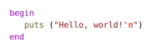
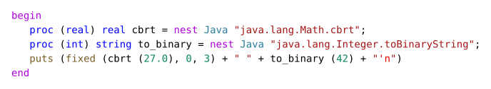
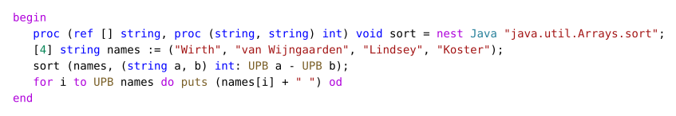
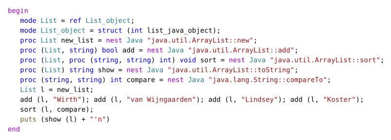
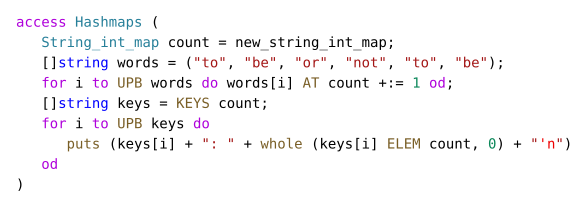

# a68j - Algol 68 on the JVM

Algol 68 anticipated by decades much of what modern languages take for
granted - orthogonal design, expression orientation, type-safe unions,
user-defined operators and built-in concurrency - and its ideas live on
in languages such as C++ and Python.

**a68j** compiles [Algol 68](https://en.wikipedia.org/wiki/ALGOL_68) to Java
bytecode. Its front end is a faithful, file-by-file Java port of [ga68](https://gcc.gnu.org/wiki/Algol68FrontEnd),
the Algol 68 front end of GCC. The back end generates JVM class files with
the JDK's ClassFile API.

It is verified by differential testing against ga68. Every program in the
test corpora must produce the same output and exit status on the JVM as
with **ga68**:
- the ga68 test suite,
- more than 500 Rosetta Code programs,
- the project's own tests.

[](examples/hello.a68)

```
$ java -jar a68j-backend.jar -run hello.a68
Hello, world!
```

## Why

- **Same language as ga68.** a68j reads the dialect that GCC's Algol 68
  front end reads: GNU Algol 68 with [SUPPER stropping](https://algol68-lang.org/docs/GNU68-2025-004-supper.html/index.html)
  (the default) or UPPER stropping, modules (`module … def … fed`, `access`)
  and formal holes. It reports the same diagnostics at the same positions,
  because scanner, parser, mode checker and the other passes are the ported
  ga68 code.
- **Runs wherever Java runs.** One jar, no native toolchain.
- **Reasonably fast.** About as fast as ga68 without optimisation, about
  half as fast as ga68 `-O2` (plus the JVM's start-up). Values of the
  primitive modes are kept unboxed, calls are direct, and the generated
  code is shaped for the JIT. See [Performance](#performance).
- **Java interoperability** (an a68j extension, off by default):
  `nest Java "java.lang.Math.cbrt"` binds a Java method like ga68's
  `nest C` binds a C function. Algol 68 procedures can be passed as Java
  functional interfaces (a comparator for `Arrays.sort`, say) and come
  back as procedures. Constructors, instance methods and fields are bound as
  method references (`nest Java "java.util.ArrayList::new"`), so objects of
  the JDK can be used directly. Two bundled modules, `Lists` and
  `Hashmaps`, provide growable lists and hash maps built on it.

## Status

| Check | Result |
|---|---|
| Front end vs. ga68 | trees after semantic analysis identical node by node; same diagnostics |
| ga68 test suite (execution tests) | 471 of 472 (the other one prints `argv (1)`, the path of the executable, which necessarily differs) |
| a68j's own differential tests (`tests/extra`) | 31 of 31 |
| Rosetta Code programs that ga68 runs | 608 identical (560 of them end normally), 2 equal up to floating-point rounding, 8 open, of 618 |
| Module tests built as library jars | 25 of 25 |
| Java interop and bundled modules (`tests/java`) | 44 of 44, JDK 25 and JDK 28 |
| Parallel clauses with real threads (`tests/par`) | 14 of 14, JDK 25 and JDK 28 |

Not supported, as in ga68: the transput of the Revised Report (`print`,
`newline`, `put`, `$…$` formats); output goes through the POSIX
prelude (`puts`, `putchar`, `fputs` ...). The bundled module
`Genie_Transput` provides `print`, `newline`, `put`, `read`, `get`, `open`,
`associate` and `stand_out` in the style of Algol 68 Genie on top of it, for a68j and
ga68 alike
([docs/genie-transput.md](docs/genie-transput.md)). 80-bit
`long long real` is out of scope.

## Requirements

- **JDK 25** or later to build and run. JDK 28 is optional: with it the jar
  also contains a version of the PAR runtime based on structured
  concurrency.
- A POSIX shell to build (Linux, macOS, WSL or Git Bash on Windows).
- For the differential tests only: a build of GCC with Algol 68 (`ga68`)
  and Python 3.

## Build

```sh
cd backend
JDK25=/path/to/jdk-25 sh build.sh
```

This builds the front end (`a68j.jar`) and then `backend/a68j-backend.jar`,
which contains everything: front end, code generator, runtime, the
standard prelude and the bundled modules. Next to the jar it writes
`a68j-backend.aot`, an AOT cache that shortens the start of the compiler
(JEP 483). The cache is optional. It also writes `a68j-runtime.jar`,
which holds only the runtime, the standard prelude and the bundled
modules: what a compiled program needs to run, without the compiler.

## Usage

Compile and run in one step:

```sh
java -jar a68j-backend.jar -run program.a68 [arguments]
```

Compile to class files, then run them:

```sh
java -jar a68j-backend.jar program.a68 -d out
java -cp a68j-backend.jar:out Program      # class named after the file
```

To ship a compiled program, `a68j-runtime.jar` is enough in place of
`a68j-backend.jar`. Library jars of modules (`-d libX.jar`) and the Java
classes that `nest Java` code uses go on the class path as well, in the
same way:

```sh
java -cp a68j-runtime.jar:lib/libmymod.jar:out Program
```

The runtime jar must come from the same version of a68j as the compiler
that compiled the program.

Common options (as in ga68 where ga68 has them):

| Option | Meaning |
|---|---|
| `-fstropping=supper` / `-fstropping=upper` | stropping regime (default: SUPPER) |
| `-std=algol68` / `-std=gnu68` | strict Algol 68 or the GNU dialect (default) |
| `-I dir`, `-L dir` | where to find module interfaces (`X.m68`, `libX.jar`) |
| `-fmodules-map=…`, `-fmodules-map-file=…` | map module names to files, as in ga68 |
| `-d dir` | output directory; `-d libX.jar` adds a module to a library jar |
| `-run` | compile in memory and run |
| `-fnest-java`, `-fjava-classpath=…` | allow `nest Java "…"` formal holes (a68j extension) |
| `-fpar-threads` | run the units of `par` clauses in parallel threads (a68j extension) |

### Modules

A module packet compiles to a class and an interface file `x.m68`. The
interface file is byte-identical with the `.a68_exports` section that ga68
writes for the same module. Several modules can go into one library jar:

```sh
java -jar a68j-backend.jar mymod.a68 -d lib/libmymod.jar
java -jar a68j-backend.jar -I lib -run program.a68
```

### Java methods and the bundled modules

[](examples/java-methods.a68)

```sh
java -jar a68j-backend.jar -fnest-java -run java-methods.a68
3.000 101010
```

Calls of such procedures go straight to the Java method: no boxing, no
argument arrays.

Procedures go to Java as objects of functional interfaces, and names of
rows as arrays that are copied back after the call:

[](examples/java-sort.a68)

```sh
java -jar a68j-backend.jar -fnest-java -run java-sort.a68
Wirth Koster Lindsey van Wijngaarden
```

Objects of any Java class are used through method references:
`Class::new` is a constructor, `Class::name` an instance method called on
the first parameter, or a public field if no method fits. In Algol 68
such an object is a name, and Java's
`null` is `nil`:

[](examples/java-objects.a68)

```sh
java -jar a68j-backend.jar -fnest-java -run java-objects.a68
[Koster, Lindsey, Wirth, van Wijngaarden]
```

The bundled module `Lists` offers growable lists
(`Intlist`, `Reallist`, `Stringlist`, …). `Hashmaps` offers hash maps for
`int`, `long int` and `string` keys (`String_int_map`, …). They need no
option:

[](examples/hashmaps.a68)

```sh
java -jar a68j-backend.jar -run hashmaps.a68
to: 2
be: 2
or: 1
not: 1
```

## Performance

Measured on the 528 Rosetta Code programs that run with both, each
program run on its own, one after the other, on the same machine (times
include process start):

| | Total |
|---|---|
| ga68 `-O0` | 30.2 s |
| ga68 `-O2` | 16.7 s |
| a68j (JDK 25) | 71.3 s, of which about 42 s is JVM start-up (~0.08 s per program) |

For the 22 programs that run at least 0.3 s:

| | Total | Median ratio |
|---|---|---|
| a68j | 14.3 s | |
| ga68 `-O0` | 23.5 s | a68j / ga68 `-O0` = 0.82 |
| ga68 `-O2` | 13.2 s | a68j / ga68 `-O2` = 2.2 |

So **a68j** is roughly as fast as unoptimised **ga68**, mostly faster on
longer-running programs, and about half as fast as ga68 `-O2` in the
median.

On a long-running program the gap to `-O2` closes:
`tests/perf/big-program-1-long.a68` (14 numeric kernels in one main
program, ten times the work of `big-program-1.a68`), median of three runs:

| | Time |
|---|---|
| ga68 `-O0` | 97.6 s |
| ga68 `-O2` | 30.1 s |
| a68j (JDK 25) | 36.8 s |

(ga68 needs `ulimit -s unlimited` for this program, otherwise it crashes
in the last kernel.)

The JVM needs about 60 ms to start, which dominates short programs.

Techniques used:
- unboxed values and rows of the primitive modes;
- variables kept in JVM locals;
- direct calls with typed entries, also across modules through
  `invokedynamic`;
- bounds checks and element access inlined in the bytecode;
- copies of values avoided where no one can observe them;
- loops as methods of their own, so that a long main program or
  procedure does not exceed the 8000 bytes of bytecode above which
  HotSpot does not compile a method at all, and each loop of the main
  program, nested ones too, is compiled on its own rather than by
  on-stack replacement of the whole program.

## Editor support

- `editors/vscode-algol68`: a TextMate grammar and a VS Code extension for
  GNU Algol 68 with SUPPER stropping. It is checked token by token against
  the scanner over all test programs.
- `editors/a68html`: renders source as highlighted HTML or SVG with the
  same grammar. SVG is the way to show colored Algol 68 in Markdown on
  GitHub.

## Repository layout

```
src/main/java/a68j/front/   the ported ga68 front end (one class per C file)
backend/                    code generator (a68j.jvm), runtime (a68j.rt), bundled modules
tests/extra, java, par      a68j's own tests, with expected output
tests/rosetta/              Rosetta Code programs prepared for ga68 and a68j
tools/                      test runners (differential tests against ga68) and generators
docs/                       documentation
editors/                    VS Code grammar, HTML/SVG renderer
```

The detailed documentation is in `docs/`:
- `docs/BACKEND.md`: the design rules of the back end.
- `docs/libraries-and-startup.md`: module libraries as jars.
- `docs/optimizations.md`: optimizations.
- `docs/java-modules.md`: Java interop and the bundled modules.
- `docs/genie-transput.md`: the bundled module `Genie_Transput` (`print`, `newline`, ...).
- `docs/TODO-formats.md`: formats (`printf`), not implemented yet.
- `docs/ga68-bug-reports.md`: defects found in ga68 and libga68.
- `docs/par-and-sema.md`: parallel clauses.
- `docs/editor.md`: grammar and HTML renderer.

## Testing

The differential runners compile every program with ga68 and with a68j
and compare output and exit status:

```sh
S=tests/ga68/execute              # the ga68 test suite (tests/ga68/README.md)
python3 tools/run_jvm.py --native tests/ga68/expected $S/*.a68 $S/mcgt/*.a68 $S/modules/*.a68
python3 tools/run_jvm.py --native tests/extra/expected tests/extra/*.a68
python3 tools/run_native.py --ga68 …/xgcc --libdir …/libga68/.libs --out /tmp/native tests/extra/*.a68
python3 tools/run_jvm.py --native /tmp/native tests/extra/*.a68
sh tools/java_tests.sh            # nest Java, Lists, Hashmaps
sh tools/par_tests.sh java 3      # -fpar-threads
```

## License

a68j is a derived work of ga68 (GCC) and of Algol 68 Genie and is licensed
under the **GNU General Public License, version 3 or later** (`COPYING`).
- The runtime, that is the code a compiled program needs at run time
  is licensed under the GPL version 3 or later with the **GCC Runtime Library
  Exception 3.1** (`COPYING.RUNTIME`), as libga68 is, and with an
  additional permission under section 7 of the GPL: a compilation with
  a68j counts as an Eligible Compilation Process in the sense of that
  exception. This is meant to let programs compiled with a68j be
  distributed together with the runtime under terms of their authors'
  choice; the exact terms are in the header of each file and in
  `COPYING.RUNTIME`. The compiler itself (front end and code generator)
  remains under the GPL without this exception.
- `backend/lib/standard.a68` is libga68's standard prelude, unchanged
  (GPL 3 with the GCC Runtime Library Exception 3.1).
- The VS Code extension in `editors/vscode-algol68` is under the ISC
  license. It started from https://github.com/jlguenego/vscode-algol68.
- The Rosetta Code programs in `tests/rosetta` are under the GNU Free
  Documentation License 1.3 (see the README there).

## Acknowledgements

- Jose E. Marchesi and the contributors of ga68 (the GCC Algol 68 front end),
  which a68j is ported from.
- Marcel van der Veer, author of Algol 68 Genie, from which much of ga68's
  front end descends.
- The authors of the Rosetta Code solutions.
- The creators of the Algol 68 language (IFIP Working Group 2.1) for pioneering
  many core concepts of modern programming languages.
